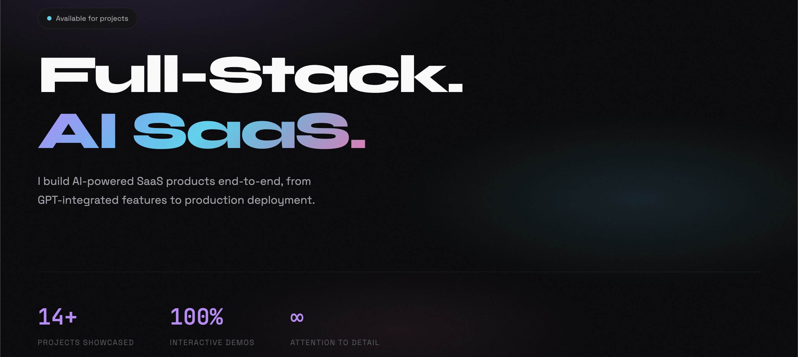
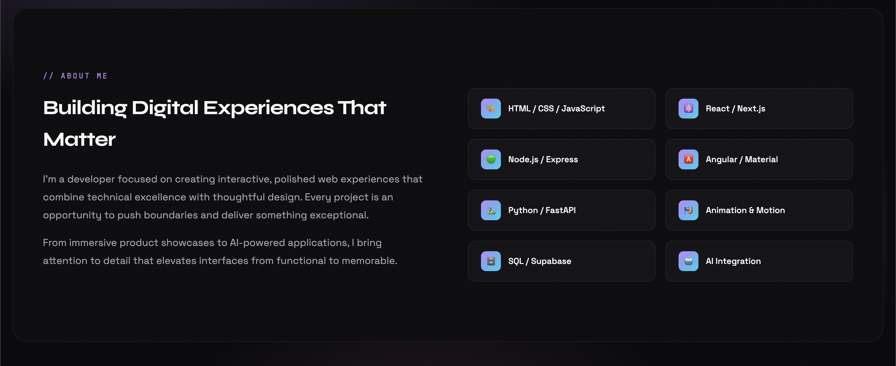
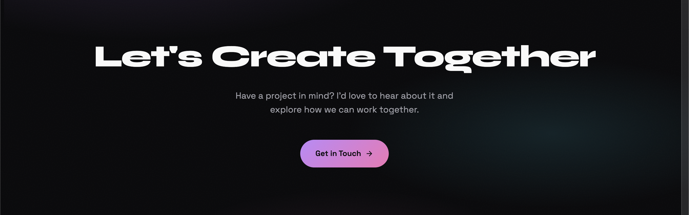

<div align="center">

# Shoaib Rana — Portfolio

**Full-stack engineer building AI-powered SaaS products end-to-end, 14 projects, from GPT-integrated features to production deployment, all with live, clickable demos.**

[](https://portfolio-pied-two-34.vercel.app/)
[](https://vercel.com)

[View Live Site](https://portfolio-pied-two-34.vercel.app/) · [Contact](mailto:shoaib.rana888@gmail.com)

</div>


---

## Overview

This repo powers my personal developer portfolio — a single-page site that showcases everything I've built, with **every project embedded or linked as a live, working demo** instead of static screenshots. The goal: let the work speak for itself.

The site is organized into three parts:

1. **Creative Interfaces** — front-end experiments (animation, canvas, speech APIs, scroll storytelling) built as standalone HTML/CSS/JS pages and embedded directly into the site via iframe.
2. **Shipped Products** — full-stack applications (AI SaaS tools, real-time multiplayer, e-commerce) that live in their own repos and are linked out to their own deployments.
3. **About / Contact** — a short bio, skill grid, and a direct way to get in touch.

No framework, no build step — the shell itself is pure HTML/CSS/JS, deployed as a static site on Vercel.

## Screenshots

<!--
Capture each of these from https://portfolio-pied-two-34.vercel.app/ at ~1440x900 (desktop)
and save into a `screenshots/` folder at the repo root with these exact filenames.
A mobile shot or two (375px wide) is a nice bonus for the "responsive" claim.
-->

| | |
|---|---|
| **Hero** — landing view with headline & stats |  |
| **Creative Interfaces** — project grid |  |
| **Shipped Products** — full-stack project grid |  |
| **About** — bio & skills |  |
| **Contact** |  |

## What's featured

### Creative Interfaces
*Standalone demo pages embedded live in this repo (`public/*.html`).*

| Project | Tags | Description |
|---|---|---|
| **[Flux — SaaS Landing Page](https://portfolio-pied-two-34.vercel.app/flux-landing.html)** | HTML · CSS · JS | Workflow-automation landing page with a mouse-reactive wave background, staggered testimonial carousel, and a dark theme with lime accents. |
| **[NOVA X1 Premium](https://portfolio-pied-two-34.vercel.app/nova-x1-premium.html)** | HTML · CSS · JS | Apple-style luxury smartphone product page — 3D rotating carousel, scroll-triggered animations, interactive color selector, glassmorphism. |
| **[Flo — Personal Finance Dashboard](https://portfolio-pied-two-34.vercel.app/finance-dashboard.html)** | SvelteKit · Chart.js · TypeScript · Tailwind | Interactive finance dashboard — live transaction tracking, budget monitoring across 6 categories, animated Chart.js visualizations. |
| **[VoiceHire AI Interviewer](https://portfolio-pied-two-34.vercel.app/ai-voice-interviewer.html)** | AI · Web Speech API · JavaScript | AI interview system with real-time speech recognition, text-to-speech, live waveform visualization, and automated scoring. |
| **[Atmosphere Weather](https://portfolio-pied-two-34.vercel.app/atmosphere-weather.html)** | CSS Animations · Dynamic Themes | Weather app with theme switching by condition (rain, snow, thunderstorms, sun), particle effects, hourly forecasts. |
| **[Elena Vance — Pen Story](https://portfolio-pied-two-34.vercel.app/pen-story-v4.html)** | Scroll Animation · Storytelling | Scroll-driven narrative with an interactive fountain pen that opens and closes as you read. |
| **[EIDOLON — The Last Signal](https://portfolio-pied-two-34.vercel.app/space-exploration.html)** | Canvas · Storytelling · JavaScript | Story-driven space exploration through four alien environments, piecing together an 11,000-year-old mystery. |

### Shipped Products
*Full-stack applications, each in its own repo and deployment.*

| Project | Tags | Description |
|---|---|---|
| **[Nufitionist — AI Health & Fitness Coach](https://fitness-flutter-app.vercel.app/)** | Flutter · Dart · ChatGPT | Cross-platform (Web/Android/iOS) fitness coaching app from a single codebase, with an integrated ChatGPT-powered coach. |
| **[Duel Arena](https://dual-arena.vercel.app/)** | React · Ably · WebSockets | Real-time multiplayer platform with four classic games — shareable room codes, live chat, zero dedicated backend. |
| **[EVENTIX — Booking Platform](https://portfolio-wjt8.onrender.com)** | Node.js · Express · SQLite · React | Booking platform with an event ticketing system (interactive seat maps) and a salon appointment system, sharing one concurrency engine with race-condition protection and QR ticketing. |
| **[VueStore — E-Commerce Platform](https://vuestore-tgsz.vercel.app/)** | Vue 3 · Laravel 12 · TypeScript · MySQL | Full e-commerce solution — product browsing, cart, wishlist, role-based auth, and an admin dashboard. |
| **[E-Commerce Analytics Dashboard](https://ecom-analytics-ten.vercel.app/)** | Angular 17 · FastAPI · MongoDB | Enterprise-grade analytics platform with real-time KPIs, sales charts, and acquisition-funnel analysis on an async FastAPI/MongoDB backend. |
| **[JobTrackr](https://job-trackr-gamma-lilac.vercel.app/)** | Next.js 14 · FastAPI · Supabase · OpenAI | AI job-application tracker — Kanban dashboard, GPT-4o mini resume match scoring and cover-letter generation, Supabase row-level security. |
| **[ReviewQR](https://google-reviews-wine.vercel.app)** | Next.js · Supabase · TypeScript | QR-based review management for small businesses — routes high ratings to Google Reviews, captures low ratings privately. |

## Tech stack

**This repo (the portfolio shell):**
- Pure HTML / CSS / JavaScript — no framework, no build step
- Google Fonts (Syne, Space Grotesk, JetBrains Mono)
- Live demos embedded via `iframe`
- Served locally with [`serve`](https://www.npmjs.com/package/serve)
- Deployed as a static site on **Vercel**

**Across featured projects:** React, Next.js, Vue 3, Angular 17, SvelteKit, Node.js/Express, FastAPI, Laravel 12, Flutter, Supabase, MongoDB, MySQL, Ably (WebSockets), OpenAI/GPT-4o.

## Getting started

```bash
git clone https://github.com/ShoaibRana888/portfolio.git && cd portfolio
npm install && npm start   # → http://localhost:3000
```

## Roadmap

- [ ] ML-powered predictive analytics for the Analytics Dashboard
- [ ] Additional case-study write-ups per project

## Contact

**Shoaib Rana** — Full-stack developer

📧 [shoaib.rana888@gmail.com](mailto:shoaib.rana888@gmail.com)
🔗 [Portfolio](https://portfolio-pied-two-34.vercel.app/) · [GitHub](https://github.com/ShoaibRana888)
